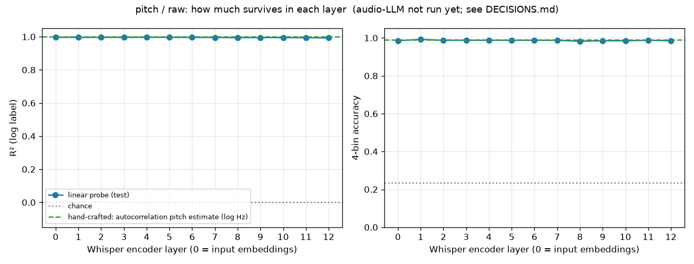
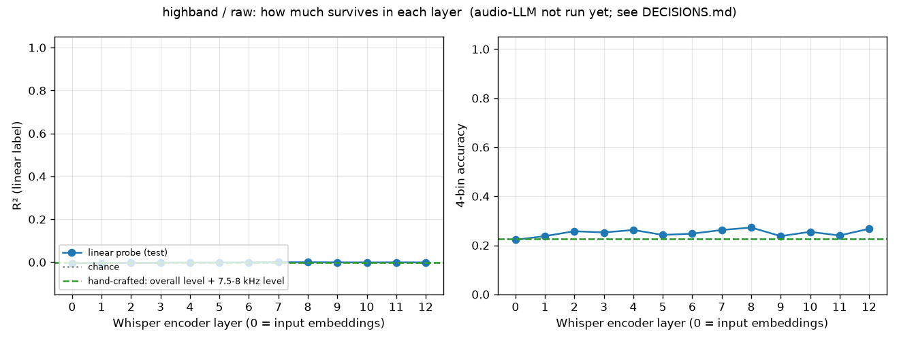
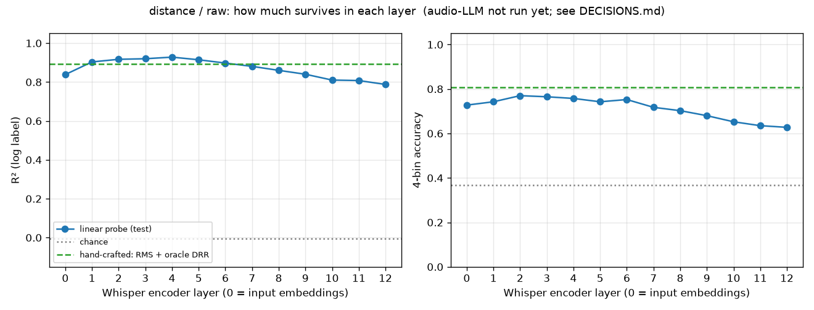
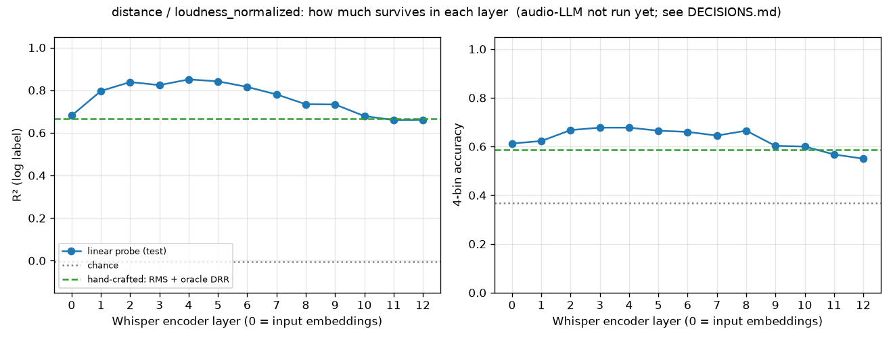
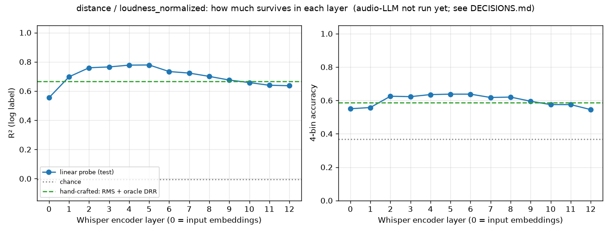

# Results

Every number below comes from `make all` with seed 0 (rerun end to end on 2026-10-19 and
reproduced exactly). Each property has 2000 clips: 1600 train and 400 test, split so that no
room or source appears on both sides. The probe is a ridge regression (for the number) or a
4-bin logistic regression (for multiple choice) on one Whisper-small encoder layer.

**The audio-LLM stage has not been run.** The model is a 16 GB download, held back on
purpose (see [DECISIONS.md](DECISIONS.md)), so there is no LLM line on the charts yet and
no "richness lost" gap. Everything else is complete.

## Summary

| property | condition | best layer | best R² | layer 12 R² | best 4-bin acc (chance) | hand-crafted R² | LLM |
|---|---|---|---|---|---|---|---|
| pitch (positive control) | raw | 0 | **0.997** | 0.993 | 0.993 (0.235) | 1.000 (autocorrelation) | not run |
| highband (negative control) | raw | 7 | **-0.000** | -0.001 | 0.273 (0.228) | -0.001 | not run |
| distance | raw | 4 | **0.928** | 0.788 | 0.770 (0.367) | 0.894 (RMS + oracle DRR) | not run |
| distance | loudness_normalized | 4 | **0.851** | 0.661 | 0.677 (0.367) | 0.666 (RMS + oracle DRR) | not run |
| distance, no noise floor | loudness_normalized | 5 | **0.778** | 0.636 | 0.637 (0.367) | 0.666 | not run |

R² is measured on log f0 for pitch and log distance for distance. In plain words: R² = 1
means the probe predicts perfectly, 0 means it does no better than always guessing the
average.

## What it means

1. **The harness works.** Pitch is readable almost perfectly from every layer, and the
   9-15 kHz band, which Whisper's 16 kHz input cannot contain, is unreadable from every
   layer. The ffmpeg resampler does leak the band at about -46 dB, but that is too faint to
   matter here.
2. **Whisper encodes distance well, best in its early-middle layers.** In raw audio a
   linear probe on layer 4 predicts distance with a typical error of 0.66 m across
   0.5-10 m. The curve rises from layer 0 (0.84) to layer 4 (0.93), then falls steadily to
   layer 12 (0.79), as the encoder shifts toward what was *said* and away from *where* it
   was said.
3. **It is not just loudness.** With every clip rescaled to the same level, the best layer
   still reaches R² 0.85, beating a probe given the true direct-to-reverb ratio (0.67).
   About 0.07 of that came from the microphone hiss, which quietly re-encodes loudness
   after normalisation. With the hiss removed, R² is still 0.78, so Whisper keeps real
   room and reverb information that a single DRR number does not capture.
4. **Two simulation artifacts were checked and ruled out or measured:** leading silence
   from time of flight (removed; changed R² by less than 0.005) and the noise floor
   (measured above).

## Charts

Blue line = probe on each layer (test clips). Grey dotted = chance. Green dashed =
hand-crafted baseline. The red LLM line will appear here once the LLM stage runs.

### Pitch (positive control)


### High band (negative control)


### Distance, raw


### Distance, loudness-normalized


### Distance, loudness-normalized, no noise floor (ablation)


Per-layer PCA plots and predicted-vs-true scatter plots live next to each chart, in
`embeddings/` and `probes/`.

## Acceptance checklist (from the spec)

| criterion | status | evidence |
|---|---|---|
| Pitch control: best-layer R² > 0.9 | **pass** | 0.997 (layer 0) |
| High-band control: every layer R² < 0.1 | **pass** | all 13 layers between -0.005 and 0.000 |
| Distance: both raw and loudness-normalized | **pass** | 0.928 and 0.851 |
| LLM evaluated on >= 200 test clips per prompt type | **not done** | the 16 GB model download is held back; code and tests are in place, `n_test_clips: 400` |
| Split grouped by room and source, with a test | **pass** | `tests/test_split.py::test_real_property_splits_are_clean` |
| Generator sanity: DRR falls as distance rises | **pass** | `tests/test_distance.py` (mean DRR per distance strictly decreasing; Spearman(d, DRR) = -0.82 over the dataset) |
| Embedding runs on a laptop without a GPU, < ~1 hour | **pass on this Mac** | CPU only: 0.30 s/clip, about 40 min for all 8000 clips (Apple M5 Pro). On the GPU (MPS): 0.07 s/clip, about 9 min. Slower laptops may exceed an hour. |
| Any knob changeable from the CLI | **pass** | `make <stage> key.sub=value`, `tests/test_config.py` |
| `inspect` works on any clip ID from any run | **pass** | `make inspect PROPERTY=... CONDITION=... CLIP=... RUN=<hash>` |
| HOW_IT_WORKS.md covers every stage, formulas linked to functions | **pass** | [docs/HOW_IT_WORKS.md](docs/HOW_IT_WORKS.md) |

## To finish the LLM part

```bash
make llm report llm.allow_download=true     # downloads ~16 GB once, then asks 400 test clips x 2 prompts per run
```

That adds the red LLM line to every chart, the LLM rows to `metrics.json`, and the
"richness lost" sentence to each `report.md`.
